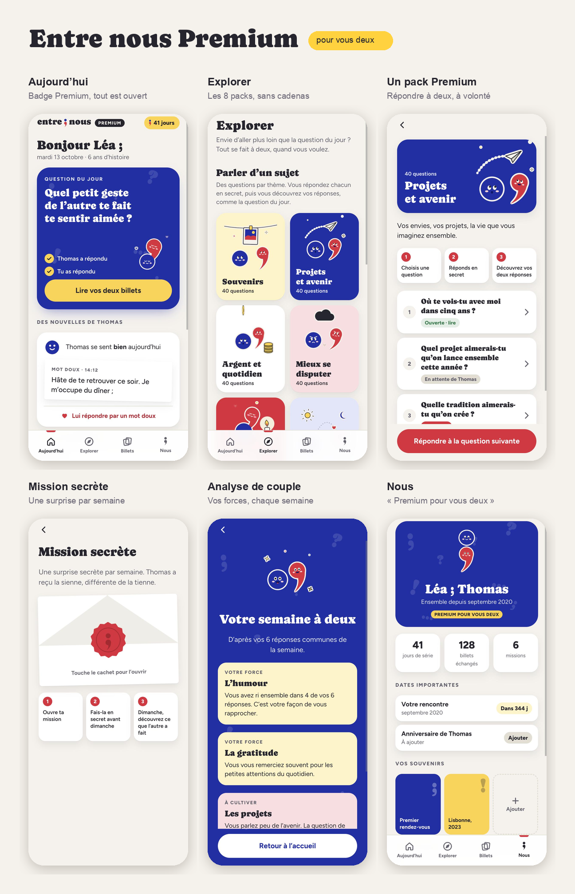

# Entre nous ;

Une question par jour, rien que pour vous deux. Entre nous est un projet d'app de couple française, pensée pour concurrencer Paired avec un ton, des contenus et une mascotte bien à nous.



## Ce qu'il y a dans ce dépôt

| Dossier | Contenu | Pour l'ouvrir |
| --- | --- | --- |
| [`prototype/`](prototype/) | Le prototype interactif : onboarding complet, paywall, puis l'app (Aujourd'hui, Explorer, Billets, Nous), en version gratuite ou Premium | `prototype/index.html` dans un navigateur |
| [`rapport/`](rapport/) | L'étude d'opportunité : Paired, pourquoi le lancer en France, chiffre d'affaires possible, graphiques | `rapport/index.html` dans un navigateur |
| [`docs/cahier-des-charges.md`](docs/cahier-des-charges.md) | Le cahier des charges du MVP : périmètre, parcours, fonctionnalités, RGPD, planning, budget | directement sur GitHub |
| [`charte/`](charte/) | La charte graphique : logo, Point et Virgule, couleurs, typographies, ton, composants | [`charte/README.md`](charte/README.md), et `charte/pistes.html` pour les 3 pistes explorées |
| [`apercus/`](apercus/) | Captures d'écran | directement sur GitHub |
| [`source/`](source/) | Le code qui génère le prototype, les mascottes et le rapport | voir plus bas |

Le plus simple pour tout parcourir : télécharger le dépôt, puis ouvrir `index.html` à la racine.

## Voir le prototype

1. Sur GitHub : **Code → Download ZIP**, puis dézipper. Ou, en ligne de commande :

   ```bash
   git clone https://github.com/Lamascotte27/entre-nous.git
   ```

2. Ouvrir `prototype/index.html` dans Chrome, Safari ou Firefox. Il faut une connexion internet pour les polices.

Sur ordinateur, le panneau de droite permet de :

- sauter à n'importe quel écran du parcours ;
- passer du parcours principal au parcours du partenaire invité ;
- basculer l'app en version **Gratuite** ou **Premium** ;
- passer en mode jour ou nuit.

Sur téléphone, le prototype s'affiche en plein écran, comme une vraie app.

Tout est simulé : les chiffres de série, l'historique et les réponses du partenaire sont des exemples, et aucun paiement n'est réel.

## La marque en bref

- **Le nom** : Entre nous, avec le point-virgule comme signe. Deux phrases liées, deux personnes liées.
- **Les mascottes** : Point (le rond bleu) et Virgule (la virgule rouge). Ensemble, elles forment le « ; ».
- **Les couleurs** : bleu `#1F2FA8`, rouge `#E1243B`, beurre `#FFD23F`, papier `#F5F2EC`, graphite `#26252E`.
- **Les typographies** : Caprasimo pour les titres, Figtree pour le texte (Google Fonts).

Le détail est dans [`charte/README.md`](charte/README.md).

## Régénérer le prototype

Il faut [Node.js](https://nodejs.org) 18 ou plus récent.

```bash
cd source/tools
npm install
```

Les poses animées des mascottes sont dessinées par `source/tools/pv-anim.js`. Pour les régénérer, il faut le fichier `Caprasimo-Regular.ttf` (gratuit sur Google Fonts) :

```bash
node gen-anim.js /chemin/vers/Caprasimo-Regular.ttf
```

Puis, pour reconstruire `prototype/index.html` :

```bash
cd ../onb
node build.js
```

Le code de l'app est dans `source/onb/` : `onb.js` (écrans et navigation), `onb-app.js` (les onglets de l'app), et trois feuilles de style.

## Partager ce dépôt

Le dépôt est privé. Pour donner l'accès à quelqu'un qui a un compte GitHub : **Settings → Collaborators → Add people**. Ou, en ligne de commande, en remplaçant `PSEUDO` par son nom d'utilisateur GitHub :

```bash
gh api -X PUT repos/Lamascotte27/entre-nous/collaborators/PSEUDO -f permission=pull
```

`pull` donne un accès en lecture seule. Mettre `push` pour autoriser les modifications.

---

Projet personnel d'Arthur Mascot, octobre 2026. Tous droits réservés.
